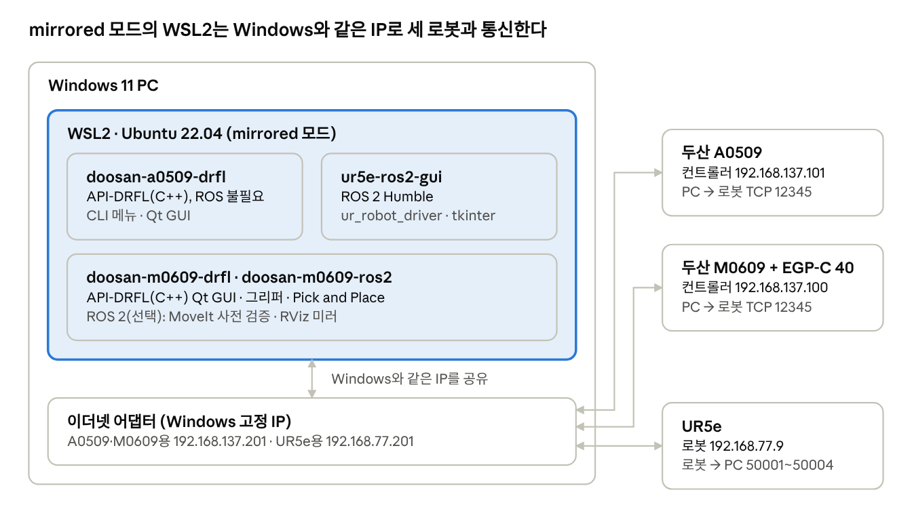

# doosan-m0609-drfl

두산로보틱스 **M0609** + **SCHUNK Co-act EGP-C 40 (1359018)** 그리퍼를 **ROS 없이** 공식 [API-DRFL](https://github.com/DoosanRobotics/API-DRFL)(C++)로 제어하는 예제입니다.
A0509용 자료([doosan-a0509-drfl](https://github.com/srbae7115/doosan-a0509-drfl))를 바탕으로 만들었으며, 그 자료와는 별개 폴더입니다.
MoveIt 사전 검증 · RViz 미러는 ROS 2 저장소 [doosan-m0609-ros2](https://github.com/srbae7115/doosan-m0609-ros2)에 있습니다(선택).
학생용 설치·실습 순서는 강의 설치 가이드 **8장**과 같습니다.

> ⚠️ **안전**: 실물 로봇을 움직이는 코드입니다. 항상 티치펜던트의 **비상정지 버튼을 손에 들고** 실행하세요.
> 프로그램의 소프트웨어 정지는 통신이 살아 있을 때만 동작하며 비상정지를 대체하지 않습니다.

## 검증 환경

| 항목 | 값 |
|---|---|
| PC | Ubuntu 22.04, x86_64 |
| 로봇 | M0609 |
| 컨트롤러 | 2.10.1 (`GF02100101`) → `DRCF_VERSION=2` |
| DRFL | GL013304 |
| 그리퍼 | SCHUNK Co-act EGP-C 40-N-N-M1013 (1359018), 두산 플랜지 직결, 24 V 디지털 I/O |
| 네트워크 | PC 192.168.137.201/24 / 컨트롤러 **192.168.137.100**:12345 |

## 구성

| 경로 | 내용 | 상태 |
|---|---|---|
| `tests/connect_test.cpp` | 연결 + 버전/상태/관절/TCP 읽기 (제어권·이동 없음) | ✅ 실기 확인 |
| `tests/flange_io_status.cpp` | 플랜지 DI/DO 읽기 (제어권·출력 없음) | ✅ 실기 확인 |
| `tests/egp_gripper_test.cpp` | 그리퍼 열기/닫기 CLI (로봇 팔은 움직이지 않음) | ✅ 실기 확인 |
| `m0609_gui/` | Qt5 GUI: MoveJ / MoveL / 직교·관절 조그 / 그리퍼 / 보호정지 해제 | ✅ 실기 확인 |
| `m0609_gui/` 📍 티칭 / Freedrive | 직접 교시(손으로 끌기) + 위치 저장 / 이동 | ✅ 실기 확인 |
| `m0609_gui/` ▶ Pick & Place | 티칭한 home / pick / place 로 15단계 Pick & Place (우회 경로, 수직 접근) | ✅ 실기 확인 |
| `docs/network_3robots.png` | 실습실 네트워크 구성도 (A0509 · M0609 · UR5e) | |

## 네트워크



| 로봇 | PC 이더넷 IP | 로봇 쪽 주소 |
|---|---|---|
| 두산 A0509 | 192.168.137.201/24 | 컨트롤러 192.168.137.101:12345 |
| **두산 M0609** | 192.168.137.201/24 (A0509와 같음) | **컨트롤러 192.168.137.100:12345** |
| UR5e | 192.168.77.201/24 | 로봇 192.168.77.9 |

```bash
ping -c 3 192.168.137.100
nc -vz 192.168.137.100 12345      # succeeded 가 나오면 됨
```

## 그리퍼 배선 / 제어 (EGP-C 40 M1013)

SCHUNK 매뉴얼(389336) "Connection version 6"의 M1013 배선표 + 실기 확인 결과입니다.

| M8 핀 | 신호 | 두산 플랜지 |
|---|---|---|
| 2 | 닫기 명령 | **DO1** |
| 3 | 열기 명령 | **DO2** |
| 1 | 센서 1 | **DI1** = 1 → 닫힘 끝 (빈손) |
| 7 | 센서 2 | **DI2** = 1 → 열림 끝 |
| 5 / 8 | +24 V / GND | 플랜지 전원 |

| DO2 (열기) | DO1 (닫기) | 동작 |
|---|---|---|
| 0 | 0 | 구동 끔 (모터 단락, 힘 없음) |
| 1 | 0 | 열기 |
| 0 | 1 | 닫기 (물체를 잡으면 힘 유지, DI1·DI2 둘 다 0) |
| 1 | 1 | 에러 해제 (과열 에러 후) |

- 두 명령 사이에는 둘 다 0인 상태를 **15 ms 이상** 유지해야 합니다 (프로그램은 50 ms).
- **쥐는 힘**은 소프트웨어로 못 바꿉니다. 그리퍼 서비스 덮개 안의 로터리 스위치(25/50/75/100 %, 최대 140 N)로 설정하며, 바꿀 때는 '구동 끔' 상태여야 합니다.
- Servo ON 없이 **제어권만 있으면** 플랜지 출력이 바뀝니다.

```cpp
robot.set_tool_digital_output(GPIO_TOOL_DIGITAL_INDEX_2, false);  // 열기 off
robot.set_tool_digital_output(GPIO_TOOL_DIGITAL_INDEX_1, true);   // 닫기 on
bool closed_empty = robot.get_tool_digital_input(GPIO_TOOL_DIGITAL_INDEX_1);
bool open_end     = robot.get_tool_digital_input(GPIO_TOOL_DIGITAL_INDEX_2);
```

## 설치 / 빌드

```bash
sudo apt install -y build-essential cmake git qtbase5-dev
cd ~ && git clone https://github.com/srbae7115/doosan-m0609-drfl.git && cd doosan-m0609-drfl
scripts/setup_drfl.sh          # 공식 API-DRFL을 third_party/에 클론 (없으면 ~/doosan_ws/API-DRFL 사용)
scripts/build_all.sh 2         # 컨트롤러 2.x → 2
```

## 사용법

```bash
./tests/connect_test 192.168.137.100        # 읽기 전용 연결 확인
./tests/flange_io_status 192.168.137.100    # 읽기 전용 플랜지 I/O 확인
./tests/egp_gripper_test 192.168.137.100    # 그리퍼: o 열기 / c 닫기 / x 구동 끔 / a 에러 해제 / i 읽기 / q 종료
./m0609_gui/build/m0609_gui                 # GUI
```

### GUI

1. IP `192.168.137.100` 확인 → **[연결]** → TP 팝업 승인 (또는 '강제 제어권 요청' 체크)
2. 자동 Servo ON → STANDBY / AUTONOMOUS가 되면 이동 버튼 활성화
3. **그리퍼** 패널: 열기 (`O` 키) / 닫기 (`C` 키) / 구동 끔 / 에러 해제, 상태(열림 / 닫힘(빈손) / 물체 잡음)와 DO1·DO2·DI1·DI2 표시
4. **정지**: 빨간 버튼 / `Esc` / `Space`
5. **보호정지 해제**: 충돌 감지 등으로 노란불(SAFE_STOP)이 되면 원인 확인 후 [보호정지 해제] → 조그로 천천히 빼내기 (비상정지는 TP에서 해제)

### 티칭 → Pick & Place (UR5e GUI와 같은 흐름)

1. 메인 창 **[📍 티칭 / Freedrive]** → **[✋ 직접 교시 모드 시작]** (로봇이 MANUAL 모드가 됨)
2. 로봇 손목(콕핏)의 **직접 교시 버튼을 누른 채** 팔을 끌어 위치를 잡음 → 버튼을 놓으면 고정
3. 빠른 저장 **[home] [pick] [place]** → `~/m0609_points_<로봇 시리얼>.json`
   - pick / place 는 "그리퍼를 닫으면 바로 잡히는 높이", 그리퍼가 **아래를 보는 자세**로 저장
4. **[직접 교시 종료]** (AUTONOMOUS 복귀) → 필요하면 메인 창 조그로 미세 조정 후 다시 저장
5. 메인 창 **[▶ Pick & Place]** → 설정 확인 → 실행

순서(15단계): 열기 → home → pick 위 이동 높이 → 수직 하강(접근점) → pick 하강 → 닫기·파지 확인
→ 접근점 상승 → 이동 높이 상승 → place 위 수평 이동 → 수직 하강(접근점) → place 하강 → 열기 → 상승 → 이동 높이 → home
(자세한 내용은 아래 "Pick & Place 우회 경로")

- **Freedrive**: DRFL에는 UR의 `freedrive_mode()` 같은 소프트웨어 명령이 없습니다. 두산은 MANUAL 모드에서
  손목의 직접 교시 버튼을 누르고 있는 동안만 손으로 움직일 수 있습니다 (버튼을 놓으면 즉시 고정되어 UR보다 안전).
- **접근점**: 저장 위치 바로 위(베이스 Z 방향 = 책상에 수직)로 접근 높이만큼. 이동 높이 지점은 `amovejx`에 저장 당시의
  solution space(팔 자세: 어깨/팔꿈치/손목)를 넘겨 자세가 뒤집히지 않게 합니다.
- **파지 확인**: 닫기 후 DI1(닫힘 끝)=1 → 빈손 → 중단. DI1=DI2=0 → 잡음. 이동 중 DI1이 1이 되면 물체를 놓친 것으로 보고 정지.
- 그리퍼 힘은 Pick & Place 설정에 없습니다 (로터리 스위치로만 설정).
- 이 컨트롤러에서 `get_solution_space()`도 응답 없이 멈춥니다 → 모니터링의 `_tTask._iSolutionSpace` 값을 저장합니다.

A0509 GUI에서 바뀐 점:
- 기본 IP 192.168.137.100, 창 제목
- 관절 한계: M0609 사양(J3 ±150°, 나머지 ±360°)에 여유를 둔 값 (J3 ±145°, 나머지 ±350°)
- MoveL 작업 반경 검사의 어깨 높이 155.5 → **134.5 mm** (M0609, doosan-robot2 xacro), 반경 850 mm (사양 900 mm)
- 그리퍼 패널 추가 (스크롤 영역 밖에 고정)

## 주의

- TP에 TCP를 설정하지 않으면 X/Y/Z는 **플랜지 면** 기준입니다. 그리퍼와 손가락(닫힌 끝 140 mm)이 그 아래로 내려오므로 Z 하한 기본값은 155 mm입니다(아래 "책상 기준 Z 하한").
- 이 컨트롤러에서도 TCP 값은 모니터링 콜백(`_tCtrl._tTask._fActualPos[0]`)에서 읽습니다 (A0509 v2.8에서 `get_current_posx()`가 멈추던 문제 회피).

## 충돌 후 서보 ON이 안 될 때 (실기 확인 2026-11-13)

증상: 충돌로 노란불 → SAFE_OFF → Servo ON을 누르면 바로 다시 정지 (알람 7060 `COLLISION_VIOLATION`).
원인: 그리퍼나 물체가 테이블 등을 누르고 있어서, 브레이크가 풀리는 순간 그 힘을 충돌로 감지합니다.
GUI의 [보호정지 해제]나 TP의 Servo ON을 반복해도 해결되지 않습니다.

해결 (TP):
1. **안전 복구** 화면으로 들어갑니다 → 로봇에 노란불이 켜집니다.
2. 로봇 손목의 **직접 교시(손가락) 버튼을 누른 채** 팔을 손으로 잡아 접촉에서 떼어 냅니다.
3. 안전 복구를 끝내고 **Servo ON**을 누릅니다.
4. GUI에서 `Z +` 조그로 더 올린 뒤, 원인이 된 위치(예: place)를 10~20 mm 높게 다시 저장합니다.

## 책상 기준 Z 하한 (2026-11-13)
- **책상은 실습실 공통 고정값** (모든 실습 책상 동일, 학생은 측정하지 않음): 작업 영역 책상 윗면 Z ≤ 11 mm (베이스 기준).
  값과 근거는 ROS 2 저장소 `scripts/pp_scene.yaml` 의 `desk` / `table`
- 닫힌 손가락 끝 = 플랜지 아래 140 mm (실측, SCHUNK 본체 높이 123 mm)
- GUI Z 하한 기본값 200 → **155 mm** (손가락 끝이 책상 위 약 4 mm 이상)
- 하한보다 낮은 위치에 있으면 **위로 올리는 이동만 허용** (직접 교시·안전 복구 후 조그로 빼낼 수 있게)
- 직육면체 20×20 mm, 높이 60 / 50 / 40 mm 3종. 놓을 때는 바닥면에서 몇 mm 위에서 열어 떨어뜨리는 것을 권장

## Pick & Place 우회 경로 (2026-11-13)
pick ↔ place 사이를 바로 가지 않습니다. 15단계:
열기 → home(MoveJ) → pick 위 이동 높이(MoveJX) → 접근점 수직 하강 → pick 하강(느리게) → 닫기·파지 확인
(접근점 = 티칭 위치 바로 위, 베이스 Z 방향 = 책상에 수직. 이동 높이·접근점·pick/place가 한 수직선 위)
→ 접근점 상승 → 이동 높이 상승 → place 위 수평 이동 → 접근점 수직 하강 → place 하강(느리게) → 열기
→ 접근점 상승 → 이동 높이 상승 → home(MoveJ)
- 설정 "이동 높이 Z" (플랜지, 기본 350 mm): 두 접근점보다 10 mm 이상 높아야 실행
- 같은 경로를 `~/doosan_ros2_ws/scripts/pp_scene_check.py`(가상 MoveIt, 책상·그리퍼·직육면체 충돌 모델)로 사전 검증
- ✅ 2026-11-13 실기 1회 성공: 60 mm 직육면체, 15단계 우회 경로 (이동 높이 350 mm), place 에서 밑면 21.7 mm 위에서 놓음


## RViz로 같이 보기 (선택, doosan-m0609-ros2 설치 후)
GUI로 움직이는 실물을 RViz에 같은 자세로 띄웁니다. RViz 쪽은 읽기 전용이라 GUI와 동시에 씁니다. 띄우는 순서는 상관없습니다.

**터미널 1: RViz 미러** (켜 둡니다)
```bash
source ~/doosan_ros2_ws/install/setup.bash
```
```bash
ros2 launch m0609_mirror mirror.launch.py
```

**터미널 2: 제어 GUI** (새 터미널)
```bash
cd ~/doosan-m0609-drfl
```
```bash
./m0609_gui/build/m0609_gui
```

연동 확인: `J1 +` 조그 → RViz 로봇이 같이 돎 · `Z +` → 그리퍼가 올라감 · 그리퍼 [열기]/[닫기] → 손가락 색 초록/주황 ·
[▶ Pick & Place] → 노란 경로 선을 따라 움직이고 잡은 물체는 빨간 상자로 표시.
`source` 를 빼먹으면 `Package 'm0609_mirror' not found` 가 납니다.
